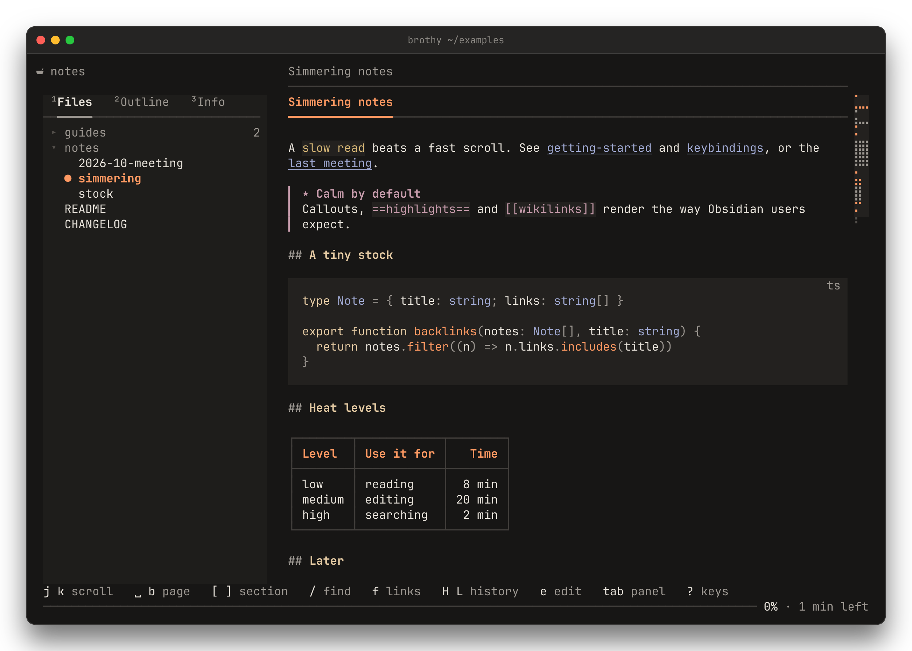
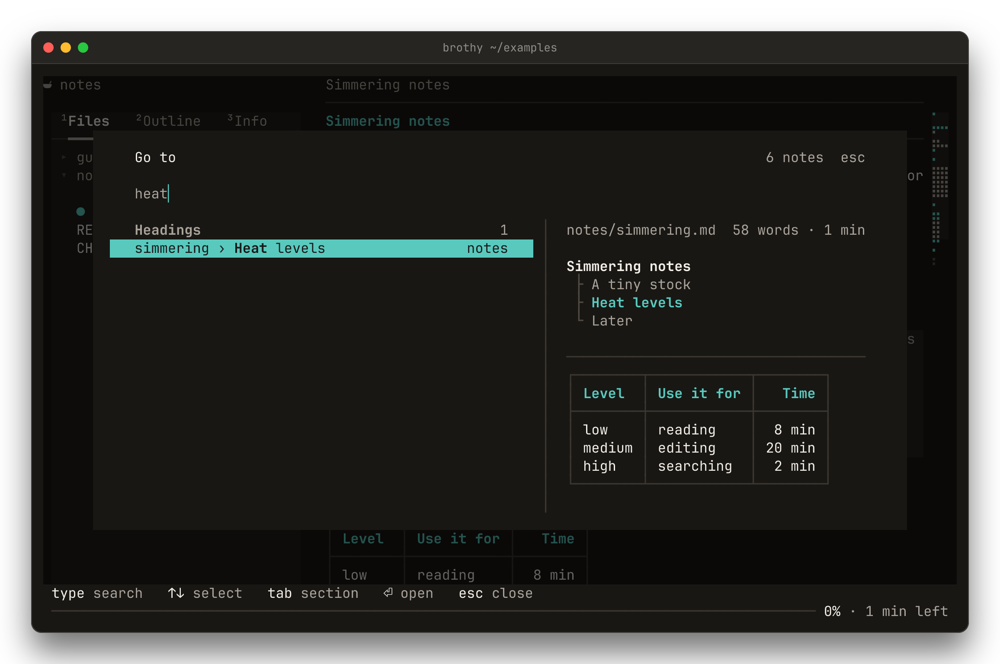
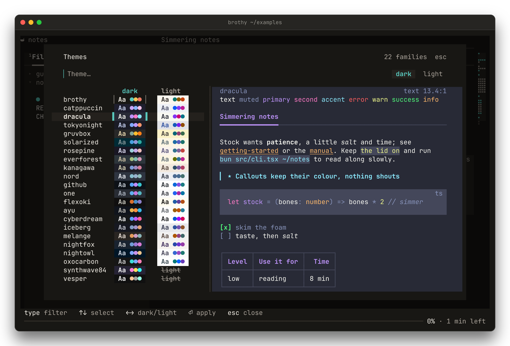
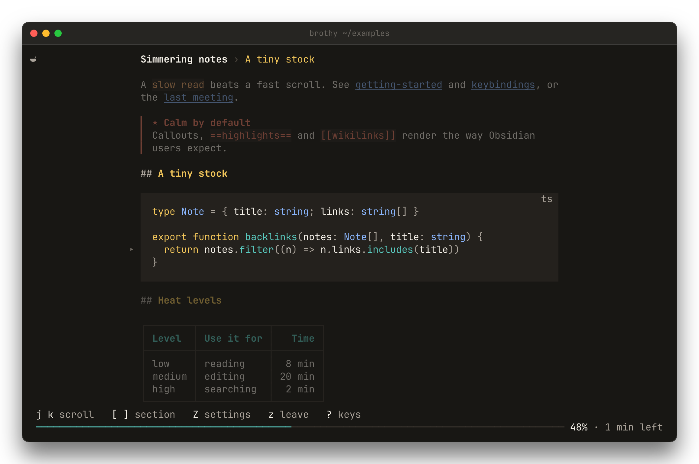
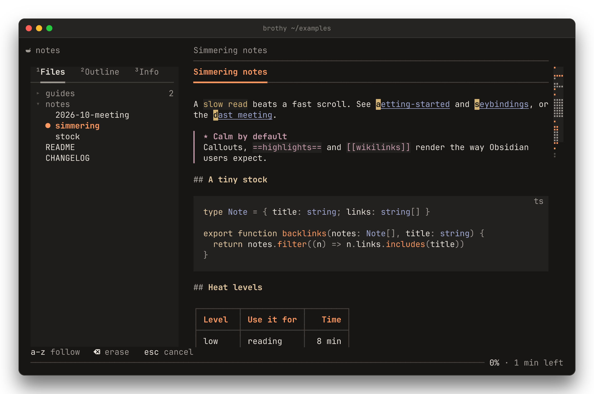
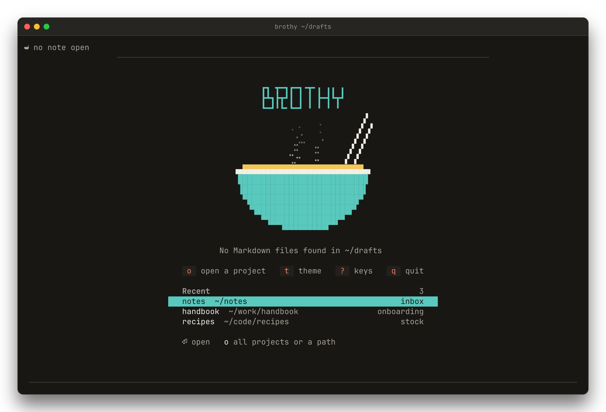
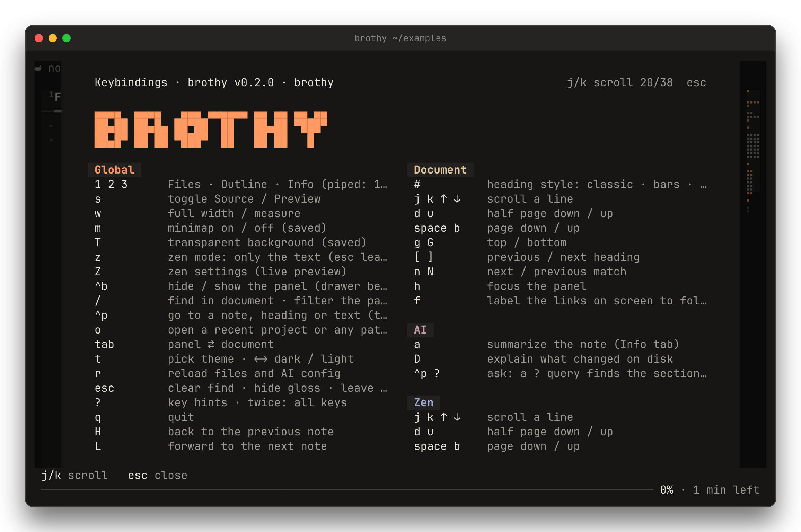
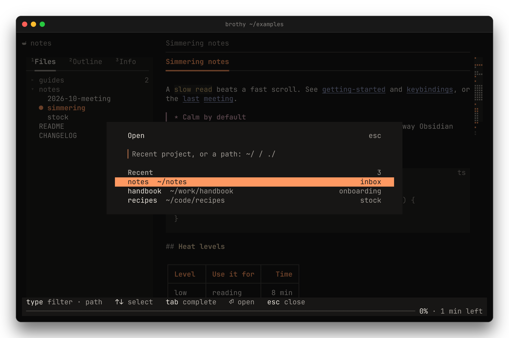
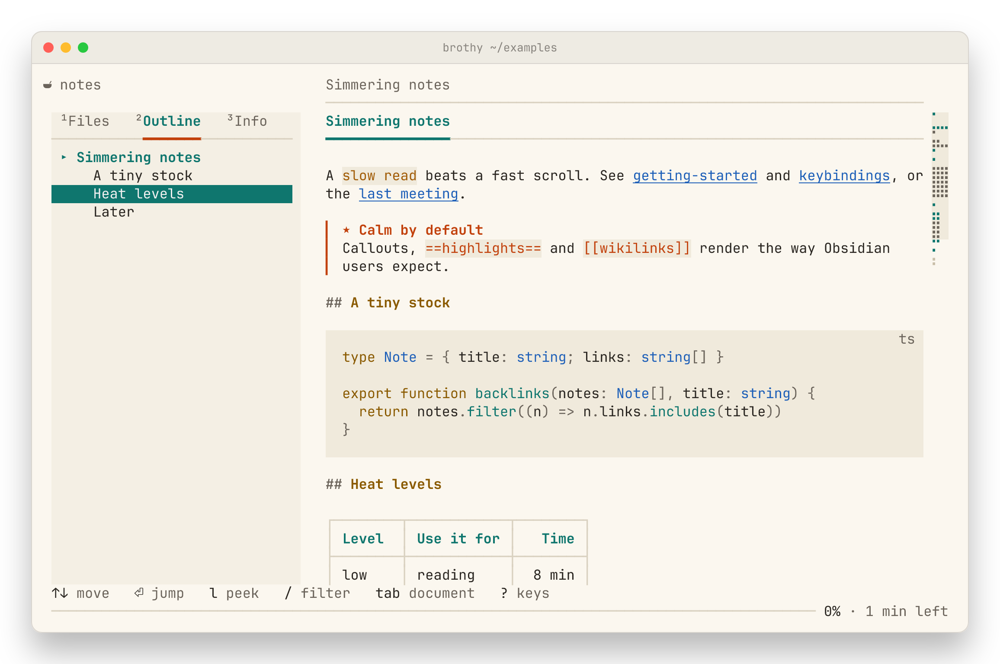

```
┏┓ ┳━┓┏━┓╺┳╸╻ ╻╻ ╻
┣┻┓┣┳┛┃ ┃ ┃ ┣━┫┗┳┛
┗━┛╹┗╸┗━┛ ╹ ╹ ╹ ╹
```

**A calm terminal Markdown reader.** Browse a folder of notes, jump anywhere with `ctrl+p`, read in
zen, and — only if you ask — let a model summarize, gloss or answer. Obsidian-flavored, live reload,
42 themes.

**Docs: https://jackmort.github.io/brothy/**

[](https://github.com/jackMort/brothy/actions/workflows/ci.yml)
[](https://github.com/jackMort/brothy/releases)
[](LICENSE)




brothy is styled after [Noodle](https://noodlerest.dev): a top line that says
where you are, a tabbed panel (Files / Outline / Info), the document at a
readable 80-column measure, and a quiet progress line. Built the same way
Noodle is: Bun, TypeScript, React and [OpenTUI](https://github.com/anomalyco/opentui).

## Install

Requirements: macOS or Linux (Windows is not supported) and a terminal with true
color and Unicode.

**Binary** — download `brothy-<os>-<arch>` for your platform (`linux` or `darwin`,
`x64` or `arm64`) and `SHA256SUMS` from the
[releases page](https://github.com/jackMort/brothy/releases), then:

```sh
sha256sum -c --ignore-missing SHA256SUMS     # shasum -a 256 -c on macOS
chmod +x brothy-linux-x64
mv brothy-linux-x64 ~/.local/bin/brothy        # any folder on your PATH
```

On macOS you may need to clear the quarantine flag first:
`xattr -d com.apple.quarantine brothy-darwin-arm64`.

**From source** (needs [Bun](https://bun.sh) 1.4 or newer):

```sh
git clone https://github.com/jackMort/brothy.git && cd brothy
bun install
bun run build                # single binary ./brothy, parsers embedded
```

brothy is not published to npm; releases ship prebuilt binaries only.

## Quick start

```sh
brothy                # browse the current folder
brothy ~/notes        # browse a folder
brothy README.md      # open one file (its folder fills the panel)
brothy -t dracula     # pick a theme (a family name opens its dark theme: -t one)
curl -s … | brothy    # read a pipe
```

Then `?` for the hints and `?` again for every key, `ctrl+p` to go anywhere, `t` for themes,
`z` for zen. From a source checkout use `bun run start [path]` (or `bun run dev` for `./examples`).

```
usage: brothy [path] [--theme <name>] [--transparent]
       command | brothy [-]

  path           a Markdown file or a folder to browse (default: .)
  -              read Markdown from stdin (also when piped and no path is given)
  -t, --theme    a family (its dark theme) or a theme: <family>-light, one-dark
                 brothy, catppuccin, dracula, tokyonight, gruvbox, solarized,
                 rosepine, everforest, kanagawa, nord, github, one, flexoki,
                 ayu, cyberdream, iceberg, melange, nightfox, nightowl,
                 oxocarbon, synthwave84 (dark only), vesper (dark only)
  --transparent  let the terminal background show through (toggle: T)
  -h, --help     show this help
  -v, --version  print version
```

`brothy` takes **at most one path**: `brothy a.md b.md` is an error, not "last one
wins" (use `--` before a path that starts with `-`). Unknown options, `-t`
without a value and unknown theme names are errors too, and it needs an
interactive terminal (stdin and stdout must be a TTY).

**From a pipe:** `curl -s … | brothy` or `brothy - < note.md` shows the piped text as a
single document titled `stdin` (up to 5 MB; more stops with `brothy: input too large (limit 5 MB)`); keys are read from `/dev/tty`, so stdout and a controlling
terminal are still required. There is no Files tab (`1` Outline, `2` Info), live reload or recent-project entry,
`e` has nothing to act on (on a note followed from it, the editor reads keys from `/dev/tty` too), `a` summarizes for this run only (never cached, glosses too), and `[[links]]` resolve against the notes under the
current folder, which is scanned in the background right after start (a link used sooner scans at once;
until then every link looks unresolved).

## Features

**Reading**
- Preview and raw Source (`s`), find in document (`/` `n` `N`), live reload on save, with the sections that changed listed in Info
- Obsidian notes: wikilinks, embeds, callouts, `==highlights==`, `%%comments%%`, dataview blocks
- Syntax-highlighted code, tables that shrink to fit, a quiet progress line
- Zen (`z`): only the text, with scroll or pages flow, spotlight, typewriter and teleprompter
- A braille minimap at the right edge from 110 columns (`m`), find hits in a lane beside it; click to jump
- `f` labels the links on screen; `H` / `L` go back and forward through the notes you opened
- `e` opens the note in your `$EDITOR` at the line you are reading; `brothy -` reads Markdown from a pipe
- Mouse: click and scroll; select text to copy it (OSC 52)

**Navigation**
- Files / Outline / Info panel (`1 2 3`) with fuzzy filter, folder counts and a reading marker
- `ctrl+p` switcher over the whole vault (notes, headings, text), with a peek pane from 100 columns: path, length, outline, cached TL;DR and first lines
- `o` opens a recent project or any folder or note
- A welcome page with a steaming bowl and your recent projects when no note is open

**AI** — opt-in, only on a key press, local models first ([details](#ai), [what is sent](SECURITY.md))
- `a` TL;DR of the note, streamed into Info and cached
- `a` in zen: a one- or two-sentence gloss of the section you are reading (`explain`, `simplify` or `translate:<tag>`)
- `D` explains what changed on disk since you opened the note; `⏎` jumps to a changed section
- `?` in `ctrl+p` asks your vault a question: the model proposes search terms, brothy finds the sections itself
- Ollama, LM Studio, OpenAI, OpenRouter, Anthropic, Gemini or any OpenAI-compatible endpoint; keys from the environment only

**Looks**
- 42 themes in 22 families, picked on a dark | light board (`t`) with a live sample note
- Transparent background (`T`, `--transparent`), a full-width toggle (`w`), a keys sheet in two columns (`?` twice)

## Screenshots

<table>
<tr>
<td></td>
<td></td>
</tr>
<tr>
<td></td>
<td></td>
</tr>
<tr>
<td></td>
<td></td>
</tr>
<tr>
<td></td>
<td></td>
</tr>
</table>

## Screen

```
 examples / README › Why another reader?                          /the 2/7   source
 
  ¹Files   ²Outline   ³Info         ## Why another reader?
 ──━━━━━────────────────────────
  ▸ guides                     2    Most terminal pagers dump Markdown as plain text.
  ▸ notes                      1    brothy renders it: headings, lists, tables, code
  ● README                          with highlighting, quotes and task lists.
    CHANGELOG
                                    • Folder tree with fuzzy filter
                                    • Find in document with n / N
 
 ↑↓ move   ⏎ open   h l fold   / filter   1 2 3 view   tab document   ? keys
 ────────────────────────────────────────────────────────────  34% · 3 min left
```

- **Top line** — a running head. The bowl logo (a Nerd Font glyph) at column 0 is muted while the file is
  watched, bright for a second after a live reload and gone while the file is
  missing. Over the panel sits the note's folder (`Home / … / Onion Soups`
  when it is long; the vault name for a root note). From the text's left edge:
  title › section, the title dimmed while the note's own heading is on screen.
  At the text's right edge: `/query i/n` while a search is active, `source` and
  `wide`. A faint rule under it spans the text column. Without the panel
  (drawer, `^b`) the folder joins the title and is the first thing dropped.
- **Panel** — `1 2 3` switch between Files, Outline and Info (the tabs carry their
  number, `¹Files`; the rule under the open tab is accent while the panel has focus). Files expands
  only the open note's path, shows folder counts, and `-` tidies the tree; `/`
  filters inline with ranked results. Outline marks the heading you are
  reading. Info shows the AI TL;DR (when asked for), the sections changed by the last live reload, properties, tags, links and stats. Below 100 columns the
  panel becomes a drawer with a scrim.
- **Ghost line** — key hints that appear when the context changes and then
  fade; also shows toasts.
- **Progress line** — `34% · 3 min left`.
- **Scan** — recursive scan for `.md`/`.markdown`/`.mdx`, skipping
  `node_modules` and hidden folders (except `.github`); symlinked folders are
  followed once, never in a loop. Collapsible folders, README first. A scan
  stops after 20,000 directory entries (so `brothy ~` stays responsive) and the
  panel says "scan stopped at 20k entries — some notes missing".
- **Preview** — headings (H1 underlined, H2+ with dim `#` markers), wrapped
  paragraphs, bold/italic/strikethrough, inline code, links, quotes, nested and
  ordered lists, task lists, box-drawn tables with alignment, and code blocks
  with a background and language label. Wrapped at 80 columns at most and
  centered. Tables shrink to fit; columns that cannot fit at all are replaced
  by a final `…` column.
  Obsidian notes read cleanly: callouts (`> [!warning] Title`) get an icon, a
  title and a bar in the kind's color (`-`/`+` folds show `▾` and stay open),
  `==highlights==` are marked, `%%comments%%` are hidden, `dataview`,
  `dataviewjs` and `tasks` blocks collapse to one row (read them with `s`), and
  known HTML tags are stripped (`<kbd>` and `<mark>` keep a style, unknown tags
  stay as text).
  Wikilinks show their alias or note name (`Note › Heading` for heading links;
  muted when no note matches); `![[note]]` embeds show `↳ note`, image and other
  file embeds a `▣ name` placeholder.
- **Code highlighting** — JavaScript, TypeScript, JSX/TSX and Zig fences are
  highlighted with OpenTUI's tree-sitter parsers (blocks appear plain for a
  moment, then fill in; line positions never move). Other languages get a
  small fallback: comments (only the comment syntax that language uses),
  strings, numbers and literals. Unknown languages stay plain.
- **Source** — `s` swaps in the raw Markdown with line numbers and coloring
  (the top line shows `source`). Comment lines are muted and callout markers
  take their kind's color.
- Find in document with `/`, `n`, `N` (Preview or Source); matches are
  highlighted and counted in the top line.
- **Minimap** — from 110 columns a braille map of the note sits at the right
  edge (Preview and Source, never zen): headings in the H1 colour, the part on
  screen on a lighter band, find hits as dots in a lane beside it. Click to jump;
  `m` hides or shows it (saved).
- **Welcome** — with no note open (a folder with no Markdown, say) brothy shows, across the whole width (no panel
  and no hint row until a note opens; the panel, `a`, `s`, `w`, `z` and `Z` keys wait for a note), the wordmark over a bowl of broth with rising steam, the keys to start (`o` `t` `?` `q`) and your recent projects
  (`↑↓` `⏎` or a click opens one). The steam stops on any key or a resize.
- Live reload when the open file changes on disk.
- Themes: 22 families, 20 with a dark theme and a `-light` twin and 2 dark-only (synthwave84,
  vesper). `t` opens a picker laid out as a board: one row per family with its dark and light
  specimens side by side (`Aa` and three accents, each on that theme's own background; a dark-only
  family's light is struck through). Type to filter, `↑↓` picks the family and `←` `→` (or `tab`) the
  mode; the cursor frames the theme being previewed and the theme in use keeps a thin frame. From 100
  columns a pane shows a sample note (marks, links, code, a callout, tasks, a table) in the
  highlighted theme. The app keeps its theme while you look; `⏎` applies it and saves it to
  `~/.config/brothy/config.json`, `esc` closes with nothing changed.
  The choice is always explicit, brothy does not follow the terminal's colors.
  - dark: brothy, catppuccin, dracula, tokyonight, gruvbox, solarized, rosepine, everforest,
    kanagawa, nord, github, one-dark, flexoki, ayu, cyberdream, iceberg, melange, nightfox,
    nightowl, oxocarbon, synthwave84, vesper
  - light: brothy-light, catppuccin-light (latte), dracula-light, tokyonight-light (day),
    gruvbox-light, solarized-light, rosepine-light (dawn), everforest-light, kanagawa-light
    (lotus), nord-light, github-light, one-light, flexoki-light, ayu-light, cyberdream-light,
    iceberg-light, melange-light, nightfox-light (dayfox), nightowl-light (Light Owl),
    oxocarbon-light
- Mouse: click tabs, files and headings, scroll with the wheel. Selecting text copies it to the
  clipboard (OSC 52, so the terminal must allow it); the ghost line says `copied 3 lines`.

## Keys

| Key | Action |
| --- | --- |
| `tab` | panel ⇄ document |
| `1` `2` `3` | Files · Outline · Info view |
| `h` · `l` | focus the panel · peek (Outline) / expand |
| `-` | Files: tidy the tree (collapse all but the open note's path) |
| `s` | toggle Source / Preview |
| `e` | edit the note in `$VISUAL` / `$EDITOR` (fallback `vi`) at the top line (`+line path`; VS Code, VSCodium and Cursor get `-g path:line`, Sublime Text `path:line`); back here when it exits, and a non-zero exit is reported |
| `a` | summarize the note with AI into the Info tab (`a` again cancels); in zen, gloss the section you are reading (see AI); needs an `ai` block in the config |
| `D` | explain what changed on disk since the note was opened, in the Info tab (`D` again cancels; `⏎` on a changed section jumps to it); needs an `ai` block |
| `w` | full width / 80-column measure (saved) |
| `T` | transparent background: the terminal's own shows through; popups, the drawer and code blocks stay painted (saved) |
| `m` | minimap on / off (saved; needs 110 columns) |
| `#` | heading style: classic · bars · ladder · rules (saved) |
| `z` | zen mode: only the text, centered (`esc` leaves; `s` shows the normal Source view) |
| `Z` | zen settings popup (`↑↓` row, `space` toggle, `←→` adjust, `⏎` save, `esc` revert) |
| `<` `>` · `+` `-` | in zen: narrower / wider text · teleprompter faster / slower (saved at once) |
| `/` | filter notes (panel focused) · find in document (`↑↓` pick a row, `⏎` apply, `esc` clear) |
| `ctrl+p` | go to a note, heading or text across the vault (`↑↓` pick, `tab` next section, `⏎` open, `esc` close); empty: recent notes; start with `?` to ask a question (see AI). From 100 columns a peek pane shows the highlighted note: path, length, outline, its TL;DR when one is cached and still fresh, and its first lines |
| `o` | open another project: recent folders (newest first, fuzzy filter) or, for a query starting with `/` `~` `.`, any folder or note (`tab` completes, `⏎` opens: a folder as the workspace, a note on its own, a recent at the note and line it was left at) |
| `j` `k` `↑` `↓` | move / scroll |
| `d` `u` · `space` `b` | half page · full page |
| `g` `G` | top · bottom |
| `[` `]` | previous · next heading (zen: section) |
| `n` `N` | next · previous match |
| `f` | label the links on screen; type a label to open the note (and jump to its heading) · `esc` cancels |
| `⏎` | open, expand or jump (Info: open the link or jump to the changed section; `j` `k` move between them) |
| `ctrl+b` | hide / show the panel (a drawer below 100 columns) |
| `esc` | per context: clear find / filter · hide the zen gloss · leave zen · close the drawer |
| `t` | theme picker (type to filter, `↑↓` family, `←` `→` / `tab` dark · light, `⏎` apply and save, a click on a specimen applies it, `esc` close) |
| `H` `L` | back / forward through the notes opened |
| `r` | rescan files, reload the note and re-read the `ai` block |
| `?` | hints; press twice for all keys, grouped Global · Document · Zen · Panel · AI, in two columns from 100 (`j` `k` scroll, any other key closes) |
| `q` | quit |

## Config

`~/.config/brothy/config.json` (or `$XDG_CONFIG_HOME/brothy/config.json` when
that is an absolute path) holds `ai` (see AI), `theme` (a theme name, or a family's: `"one"` opens `one-dark`; a name brothy does not know is reported at start and `brothy` stands in), `sidebar`, `wide` (boolean, full-width text), `transparent` (boolean; `--transparent` wins for one run), `minimap` (boolean, default `true`; `m`), `headings` (`"classic"` (default), `"bars"`, `"ladder"` or `"rules"`; `#`), `motion` (boolean, default `true`; `"motion": false` draws the welcome page still, without its ink-in and steam) and `zen`, e.g.
`{"theme": "dracula", "sidebar": {"view": "files", "hidden": false}}`.
`sidebar` replaces the old `folds`; existing `folds` are migrated once and
dropped on the next save.
`zen` holds the zen settings: `flow` (`"scroll"` or `"pages"`), `spotlight`,
`typewriter`, `ghost`, `prompter` (booleans), `wpm` (120–400) and `measure`
(60–100, or `"full"` for the whole pane minus a 2-column margin; `>` past 100 reaches it); missing or invalid fields fall back to the defaults. Zen itself always
starts off. The file is rewritten when you pick a theme, change the panel view or save
zen settings, keeping other keys; a file that does not parse is left untouched.

Recent projects live beside it in `projects.json`: up to 20 entries, newest
first, each with the folder (`root`), the note open when it was left
(`lastNote`), its Preview line (`top`) and when (`at`). The start and every
workspace opened with `o` are recorded, and updated when you switch away or
quit; a single note is recorded under its vault (or folder). The file is
only state: one that does not parse is replaced.

## AI

Off until you add an `ai` block to `config.json`. Nothing is ever sent on its own: every
request starts from an explicit key, goes to the configured endpoint only, and is the only
network traffic brothy has. Up to 3 requests run at once, over every feature below; a 4th
says `AI busy · 3 requests running` and sends nothing.

**TL;DR** — `a` sends the current note (body without front matter and `%%comments%%`, cut
to `maxChars`); the 2–3 sentence summary streams in at the top of the Info tab. Summaries
are cached and shown again for free; one made before the note changed is shown muted as
`outdated · a to refresh`. One request per note; `a` on a running note cancels it.

**Zen gloss** — in zen, `a` explains the section under the reading line in one or two plain
sentences, on a muted sheet over the bottom rows of the text (nothing is inserted into the
document). It fades when the reading line leaves the section. A gloss already made for an
unchanged section shows by itself when you reach it again, without a request; one made
before the section changed is muted as `outdated · a`, and only `a` asks for a new one.
`esc` hides the sheet (the next `esc` leaves zen); `a` while it is loading cancels. The style
is `ai.gloss`: `"explain"` (default), `"simplify"` or `"translate:<tag>"` (`translate:pl`,
`translate:pt-BR`); anything else falls back to `explain`.

**What changed on disk** — when the open note changes on disk (an editor, Obsidian, a coding
agent), the Info tab lists the changed sections with `+added −removed` line counts
and the toast says `reloaded · 2 sections changed`. That list is local and works without an
`ai` block; it compares with the text the note had when you opened it, held in memory only.
`D` sends only the changed hunks and the reply adds one or two sentences about the change
and a few words per section; `⏎` on a changed section jumps to it, to the changed line when
the reply quoted one. Once explained, the baseline moves forward, so the next edit lists
anew. A note over 2 MB is not compared (`reloaded · too large to compare`).

**Ask your vault** — in `ctrl+p`, a query starting with `?` is a question. `⏎` on the ask
row sends **only the question** (cut at 300 characters); the model returns search terms, and
the answers are sections brothy finds itself in the vault index, listed as `Answers` with the
terms shown (`searched: …`); `⏎` opens the section at its first matching line. The model never
names a note, heading or line. `↻ rerank with excerpts` is a second, separate step: only that row,
with its token cost shown first, sends the question plus up to 12 candidate sections (note
name, heading path and the first 300 characters of each); the model orders them and says why
in a few words. Nothing from the vault leaves without that row.

**What is sent, and when**

| key | request | sent |
|---|---|---|
| `a` | TL;DR | the note body, cut to `maxChars` |
| `a` in zen | gloss | note title, heading path, the section's own text (its subtree when it has under 20 words), cut to 12 000 characters |
| `D` | explain a change | note title, the changed hunks with 1 context line (each removed section: its first 20 lines), cut to 16 000 characters; later sections by heading only |
| `?` · `⏎` | ask, tier 0 | the question only |
| `?` · rerank row | ask, tier 1 | the question, and for up to 12 candidates: note name, heading path, 300 characters of text |

Front matter and `%%comments%%` are never sent. Starting a question, gloss or explanation
with no `ai` block says `AI off · set "ai" in config.json`.

Local first — no key, nothing leaves your machine:

```json
"ai": { "provider": "ollama", "model": "llama3.2" }
```

or a hosted model:

```json
"ai": { "provider": "openrouter", "model": "anthropic/claude-haiku-5-5" }
```

| field | |
|---|---|
| `provider` | a preset below, or `"custom"` |
| `model` | passed through unchanged (no default) |
| `baseURL` | required for `custom`: an OpenAI-compatible base such as `http://host:8080/v1` |
| `keyEnv` | env var holding the key (overrides the preset's) |
| `maxChars` | input limit, at least 1000 (overrides the preset's) |
| `headers` | extra request headers, e.g. `anthropic-workspace-id`, `HTTP-Referer`; `Authorization` is ignored; not sent over plain `http:` except to localhost, and their values are redacted from error toasts |
| `gloss` | zen gloss style: `explain` (default), `simplify`, `translate:<tag>` |

| provider | key from | maxChars |
|---|---|---|
| `openai` | `OPENAI_API_KEY` | 48 000 |
| `openrouter` | `OPENROUTER_API_KEY` | 48 000 |
| `anthropic` | `ANTHROPIC_API_KEY` | 48 000 |
| `gemini` | `GEMINI_API_KEY` | 48 000 |
| `ollama` | none | 8 000 |
| `lmstudio` | none | 8 000 |
| `custom` | `keyEnv`, or none | 48 000 |

Keys are read only from the environment, never from `config.json`, and are never sent
over plain `http:` to a host other than localhost. A 401/403 without a key reads
`AI: unauthorized · set keyEnv`; with one, `AI: key rejected (<ENV>)`. Ollama cuts an
over-long prompt from the front without an error: raise `num_ctx` (Modelfile) or
`OLLAMA_CONTEXT_LENGTH`, then `maxChars`. The cache is `$XDG_CACHE_HOME/brothy/summaries.json`
(else `~/.cache/brothy/`), private to your user, newest 500 notes; glosses are cached beside it in `glosses.json` (newest 2 000 sections, per style). Reload explanations and ask answers are never written to disk. The compiled binary
honors `HTTPS_PROXY` and extra CAs from `NODE_EXTRA_CA_CERTS`.

## Alternatives

[glow](https://github.com/charmbracelet/glow) (pager and note stash), [mdcat](https://github.com/swsnr/mdcat) (renders to stdout), [frogmouth](https://github.com/Textualize/frogmouth) (Python TUI browser), [bat](https://github.com/sharkdp/bat) (syntax-highlighted cat) and [Obsidian](https://obsidian.md) itself. brothy is a reader for a folder of notes, not an editor.

## Development

```sh
bun test                                    # markdown, files, config, args, nav, panel, status, zen, vault, ai, ask, delta, gloss, sections, watch, highlight, CLI and App tests
bun run typecheck
bun scripts/snapshot.tsx examples           # print a headless frame
bun scripts/snapshot.tsx examples --size 100x30 --keys "tab j s"
```

`src/markdown.ts` turns Markdown (via `marked`'s lexer) into pre-wrapped,
styled terminal lines, so scrolling, heading jumps and search all work on exact
line numbers. `src/highlight.ts` supplies code-block colors (cached; the parser
runs in a worker), `src/App.tsx` is the UI and `src/nav.ts`, `src/panel.ts` and `src/status.ts` its pure helpers.

One OpenTUI quirk worth knowing: the React reconciler doesn't clear style
props that disappear between renders, so conditional branches that render
different boxes in the same spot need distinct `key`s.

## Contributing

See [CONTRIBUTING.md](CONTRIBUTING.md) and the [Code of Conduct](CODE_OF_CONDUCT.md). Report security problems privately, as described in [SECURITY.md](SECURITY.md). Changes are listed in [CHANGELOG.md](CHANGELOG.md).

## Credits

The brothy themes follow Noodle's theme definitions (Apache-2.0). Additional palettes are
adapted from [opencode](https://github.com/sst/opencode) (MIT, © 2025 opencode), and ayu,
nightfox, Night Owl, iceberg, oxocarbon, cyberdream, melange, SynthWave '84 and Vesper from their
own repositories (all MIT; see NOTICE), all tuned for contrast (text, muted text and accents 4.5:1 or better on the page background, 3:1 or better
on code blocks); `brothy-light` is original.

## License

[Apache-2.0](LICENSE); see [NOTICE](NOTICE) for attributions.
