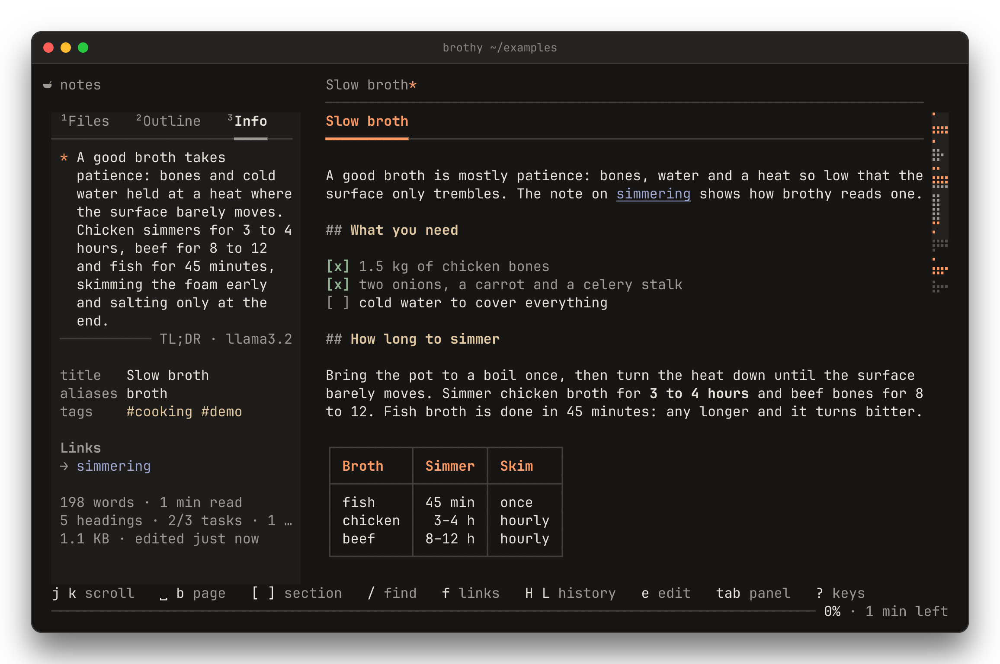
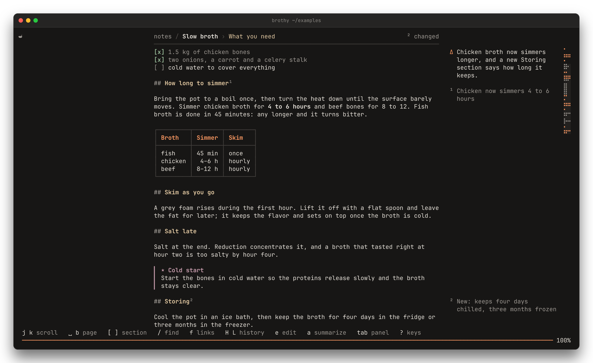

# brothy

A calm terminal Markdown reader for a folder of notes.

[](https://github.com/jackMort/brothy/actions/workflows/ci.yml)
[](https://github.com/jackMort/brothy/releases)
[](LICENSE)

<picture>
  <source media="(prefers-color-scheme: light)" srcset="docs/screenshot-light.png">
  
</picture>

Point brothy at a folder and read. `ctrl+p` jumps to any note, heading or line, zen hides
everything but the text, and the note reloads when you save it somewhere else. It reads Obsidian
vaults as they are and comes with 42 themes. AI is optional and runs only when you press a key.

[Documentation](https://jackmort.github.io/brothy/) ·
[Play the tour](https://jackmort.github.io/brothy/#tour) ·
[Keys](https://jackmort.github.io/brothy/keys/) ·
[Changelog](CHANGELOG.md)

## Install

macOS or Linux, in a terminal with true color and Unicode. Download `brothy-<os>-<arch>`
(`linux` or `darwin`, `x64` or `arm64`) and `SHA256SUMS` from the
[releases page](https://github.com/jackMort/brothy/releases), then:

```sh
sha256sum -c --ignore-missing SHA256SUMS     # shasum -a 256 -c on macOS
chmod +x brothy-linux-x64
mv brothy-linux-x64 ~/.local/bin/brothy        # any folder on your PATH
```

On macOS you may need to clear the quarantine flag first:
`xattr -d com.apple.quarantine brothy-darwin-arm64`.

<details>
<summary>Build from source</summary>

Needs [Bun](https://bun.sh) 1.4 or newer. brothy is not published to npm.

```sh
git clone https://github.com/jackMort/brothy.git && cd brothy
bun install
bun run build                # single binary ./brothy, parsers embedded
```

</details>

## Quick start

```sh
brothy                # browse the current folder
brothy ~/notes        # browse a folder
brothy README.md      # open one file (its folder fills the panel)
brothy -t dracula     # pick a theme
curl -s … | brothy    # read a pipe
```

Press `?` for hints and `?` twice for every key. `ctrl+p` goes anywhere, `t` picks a theme, `z`
starts zen and `q` quits.

## What it does

- Renders headings, tables that shrink to fit, highlighted code and task lists at a readable
  80 columns, with `s` for the Markdown source. [Reading](https://jackmort.github.io/brothy/usage/reading/)
- Reads Obsidian notes as they are: wikilinks, embeds, callouts, `==highlights==`, `%%comments%%`,
  properties and dataview blocks. [Obsidian notes](https://jackmort.github.io/brothy/usage/obsidian-notes/)
- Finds things fast: `ctrl+p` over every note, heading and line with a preview, `f` to follow a
  link by its label, `H` and `L` for back and forward. [Navigating notes](https://jackmort.github.io/brothy/usage/navigating-notes/)
- Reloads when the file changes on disk and numbers the sections that changed.
- Leaves only the text in zen (`z`): scroll or pages, spotlight, typewriter or teleprompter.
  [Zen mode](https://jackmort.github.io/brothy/usage/zen-mode/)
- Ships 42 themes in 22 families, picked on a board with a live sample (`t`).
  [Themes](https://jackmort.github.io/brothy/themes/theme-picker/)

<table>
<tr>
<td width="50%"></td>
<td width="50%"></td>
</tr>
<tr>
<td></td>
<td></td>
</tr>
</table>

## AI, off by default

> [!NOTE]
> Nothing is sent until you add an `ai` block to `~/.config/brothy/config.json` and press one of
> the keys below. Requests go only to the endpoint you configured, and brothy makes no other
> network requests. API keys are read from the environment, never from the config file.

A local model needs no key:

```json
"ai": { "provider": "ollama", "model": "llama3.2" }
```

- `a` summarizes the note and keeps the result. [TL;DR](https://jackmort.github.io/brothy/ai/tldr/)
- `a` in zen explains the section you are reading in a sentence or two. [Zen gloss](https://jackmort.github.io/brothy/ai/zen-gloss/)
- `D` explains what changed in the file since you opened it. [What changed](https://jackmort.github.io/brothy/ai/what-changed/)
- `?` in `ctrl+p` asks a question. The model only suggests search words and brothy finds the
  sections itself. [Ask your vault](https://jackmort.github.io/brothy/ai/ask-your-vault/)

<table>
<tr>
<td width="50%"></td>
<td width="50%"></td>
</tr>
</table>

It also works with LM Studio, OpenAI, OpenRouter, Anthropic, Gemini and any OpenAI-compatible
server. [Set up a provider](https://jackmort.github.io/brothy/ai/setup/) ·
[What is sent](https://jackmort.github.io/brothy/ai/what-is-sent/) · [SECURITY.md](SECURITY.md)

## Alternatives

[glow](https://github.com/charmbracelet/glow) (pager and note stash),
[mdcat](https://github.com/swsnr/mdcat) (renders to stdout),
[frogmouth](https://github.com/Textualize/frogmouth) (Python TUI browser),
[bat](https://github.com/sharkdp/bat) (syntax-highlighted cat) and
[Obsidian](https://obsidian.md) itself. brothy is a reader for a folder of notes, not an editor.

## Contributing

```sh
bun install
bun run dev          # run against ./examples
bun test
```

[CLAUDE.md](CLAUDE.md) explains how the code is laid out. See [CONTRIBUTING.md](CONTRIBUTING.md),
the [Code of Conduct](CODE_OF_CONDUCT.md) and [CHANGELOG.md](CHANGELOG.md); report security
problems privately as described in [SECURITY.md](SECURITY.md).

## Credits

The look comes from [Noodle](https://noodlerest.dev), and brothy is built the same way: Bun,
TypeScript, React and [OpenTUI](https://github.com/anomalyco/opentui). The brothy themes follow
Noodle's theme definitions (Apache-2.0). Additional palettes are adapted from
[opencode](https://github.com/sst/opencode) (MIT, © 2025 opencode), and ayu, nightfox, Night Owl,
iceberg, oxocarbon, cyberdream, melange, SynthWave '84 and Vesper from their own repositories
(all MIT; see NOTICE), all tuned for contrast; `brothy-light` is original.

## License

[Apache-2.0](LICENSE); see [NOTICE](NOTICE) for attributions.
