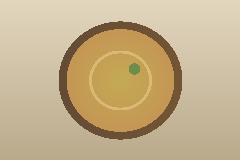

# Pictures

A picture on a line of its own is drawn in the note, where the terminal can show images (kitty, WezTerm, Ghostty, and
others that speak the kitty or sixel protocols). Elsewhere it is one row of text.

Press `⏎` to see the picture larger, in a sheet; `esc` closes it. A click on the picture does the same.

## Sizes

A width after a bar sets the size, in pixels: ``.

## Press p

`p` switches between the pictures and their text rows, and remembers it. In text mode `⏎` still opens the sheet, drawn
in half blocks.

## Problems say why

